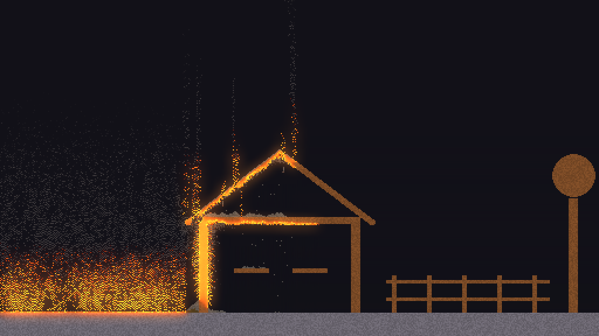

# Grave Engine

A small 2D material-simulation engine. Every pixel is a real material with real-ish
properties: sand falls, water flows, steam rises, and a **heat field** decides what
burns, melts, freezes and boils. Everything is **plain text**, so people and AI agents
can both read and change it.



## Try it

```bash
cargo run --release
```

- **Left-click** paints, **right-click** erases, **mouse wheel** changes the brush size.
- **Play / Pause** (Space), **Step**, and **Reset** (R) back to how things were when you pressed Play.
- **Heat view** (H) shows temperature: blue is cold, red, yellow and white are hot.
- Tools: **Paint**, **Erase**, **Heat** and **Cool**.
- Hover over anything to see its material, temperature and state at the bottom.
- **Save** and **Load** scenes, or pick one from **Scenes...**.

## Editing

- **👆 Select** (V): click an object, or drag a box. A box picks up the objects
  inside it, or, if there are none, an area of scenery.
- **Move** by dragging. Objects are held still while you drag them, even during
  Play. **Throw** during Play: swing an object and let go mid-swing, and it flies
  off at the speed you swung it (up to 60 m/s). **Turn** with the round handle (hold Shift for 15° steps) and **resize**
  with the square corner handle.
- **The Inspector** (right) shows what's selected in plain words: what it's made
  of, its mass, position, angle, speed and temperature. You can edit all of them.
  It also has buttons to flip, quarter-turn, resize, change material, duplicate,
  copy, delete, turn scenery into objects, or freeze objects into scenery.
- **Undo / Redo** (Ctrl+Z / Ctrl+Y) cover everything: painting, moving, deleting,
  importing, clearing, loading. Only what changed is stored, so there's no
  practical limit.
- **Keys:** Delete, Ctrl+C / X / V (pastes at the mouse), Ctrl+D duplicate,
  Q / E turn 15°, F flip, Esc deselect, Shift+click to add to the selection,
  B for the brush.

### Right-click and notes

With **👆 Select**, right-click anything:

- **An object:** change its material, leave a note, select it, follow it with
  the camera, freeze it into scenery, duplicate or delete it.
- **Scenery (ground, walls):** change that connected piece to another
  material, delete it, or leave a note.
- **Empty space:** leave a note ("add a bounce pad here", "put an explosive
  barrel here").

**Notes** are little yellow pins. A note on an object moves with it. Click a
pin to edit it, tick it done, or delete it; the 📝 Notes list (right panel)
shows them all. They're saved straight away in a file next to the scene
(`scenes/player.txt` → `scenes/player.notes.md`), each saying exactly what
it's on (an object's materials, size and position, or the scenery's
material), with a close-up picture in `scenes/player.notes/` (the object
outlined, a pin where you clicked). So you can leave notes, then ask an AI
agent to "do my notes": it reads the file and pictures, makes the changes,
and ticks them off; the editor picks up the ticks live.

### Rewind

Everything that happens during Play is recorded. Drag the **⏪ Rewind** slider under
the world back to any moment. Press Play from there and it carries on from that
moment.

### Templates

Reusable objects live as text files in [`templates/`](templates/) (`crate`, `plank`
and `cart` to start with). Pick one under **Templates** on the left, then click in
the world to place copies. Each copy can have its own changes (another material,
flipped, resized), which it remembers. Edit the template, or press **Update template
from this** on a copy, and every copy updates live, keeping its own changes. Select
any object and use **Save template** to make your own. A copy that gets burned or
broken goes its own way and is no longer linked.

In scenes, a copy is one line (see `scenes/templates.txt`):

```text
place crate 125 255 angle 15 material iron flip scale 2
```

## Materials are text files

Each file in [`materials/`](materials/) is one material. Here's wood:

```text
state = solid
density = 700
color = #7a4a26
conducts_heat = 0.15
catches_fire_at = 300
burns_for = 240
burns_into = ash
burns_into_chance = 0.1
```

**Edit a file while the sandbox is running and it updates instantly.** Add a new
`.txt` file and the new material appears in the palette. Every key is explained in
[`materials/README.md`](materials/README.md).

There are no special cases like "fire burns wood". Wood burns because it got hotter
than its `catches_fire_at` while touching air. Water boils because it passed its
`boils_at`. One set of rules covers every material.

### Play with any material's settings

Right-click a material in the list (or press **⚙ … settings** under it, or
right-click something in the world and pick its ⚙ settings) to open its
settings: sliders for colour, glow, weight, grip, bounce, bounce-pad launch,
how powders slide and liquids flow, heat (melting, boiling, freezing points),
fire (when it catches, how long it burns, how hot), strength and toughness,
explosions, and how likely each reaction is (like sand soaking up water).

- Changes apply straight away, even while it's playing.
- Hover a slider to see the default. Anything you've changed gets a **↺**
  button to put it back, and **Reset all to default** forgets every change
  to that material.
- Your changes are kept separately in `materials/my_settings/NAME.txt` (only
  the settings you changed), laid over the defaults in `materials/NAME.txt`,
  which are never touched. Delete a file there to reset that material. The
  folder isn't uploaded to git, so experiment freely.

## Scenes are text files too

```text
size 512 288
fill air
rect stone 0 268 512 20        # material x y width height
circle water 100 200 20        # material x y radius
line wood 10 10 50 50 3        # material x1 y1 x2 y2 thickness
heat circle 60 238 4 600       # set the temperature (°C) somewhere
```

Saved scenes also hold a character grid (one character per cell, with a `legend`).
See the top of [`src/scene.rs`](src/scene.rs) for the full format, and
[`scenes/`](scenes/) for examples.

## Objects and physics

Painted things stay put, like scenery. **Objects** are solid things that fall, tumble,
stack, float or sink, and break apart when pieces burn, melt or get cut off. They are
still made of real material cells, so a wooden crate burns and an ice block melts.
Physics is done by [Rapier](https://rapier.rs). One cell is 10 cm.

- In the window: pick **📦 Make object** and drag a box around something you painted.
- In a scene: `body rect wood 100 50 20 10` or `body circle stone 200 40 6`.
- **Painted solids need support.** When something burns, melts or gets erased, any
  solid piece that's no longer connected to the ground (the edge of the world) breaks
  loose and falls. Burn the wall under a roof and the roof comes down. Things you paint
  floating in the air stay put until they're damaged.
- **Overhangs snap.** Each material's `strength` is how far it can stick out from a
  support: wood reaches 5 m (50 cells), iron 15 m. A beam that's too long breaks off
  at that point, so buildings need posts, like real ones.
- Things float if they're lighter than the liquid they're in (wood on water) and sink
  if they're heavier (iron).

## Air currents and wind

The air has gently swirling currents everywhere, so smoke, steam and flames billow,
curl and drift instead of rising in straight columns. Hot smoke rises; once it cools
it hangs and spreads. Gases blown into walls slide up and over them. Two scene
settings control the air:

```text
wind 3          # steady wind in m/s (+ blows right, - left)
turbulence 1    # how swirly the air is (0 still, 1 normal, 3 stormy)
```

## Forces: impacts, weight, friction and explosions

Try `scenes/forces.txt`.

- **Impacts and weight crack things.** Every hit's force comes from the physics, so
  heavier and faster objects hit harder. If it beats a material's `toughness`, that
  spot cracks: stone crumbles to gravel, wood splinters into flying pieces, and ice
  shatters. Drop an iron block on a wooden bridge and it smashes through. A gentle
  landing doesn't break anything.
- **Metal bends.** Iron and brass objects hit hard enough bend and stay bent, at their
  weld or hinge (a bike fork bends where it meets the frame) or in the middle. Thin
  parts bend first, red-hot metal bends easily and gets weaker the hotter it is
  (`softens_at`), and a huge hit tears it in two. Set it per material with `yield`.
- **Friction and bounce** are per material. Things slide off ice, and grip stone.
  Slopes are smooth, so blocks slide and carts roll downhill.
- **Explosions.** Gunpowder goes off when it gets hot, even buried. The blast cracks
  things, throws objects, scatters burning splinters and lights fires. Neighbouring
  gunpowder sets off in a chain.

## Wet sand

Try `scenes/beach.txt`. Sand slowly soaks up water that touches it (the
water is used up) and turns into darker **wet sand**. Wet sand is clumpy:
it holds steep shapes, so you can build a sandcastle that stands, while the
same castle in dry sand slumps into a heap. Its damp creeps slowly into dry
sand next to it, its surface dries out in the air over time, and heat (fire,
lava, the Heat tool) dries it straight away. All of it is in the material
files: a `reaction` on sand, and `slides` (how readily a powder slides down a
pile) on wet sand.

## Flying pixels: blasts and splashes

Try `scenes/splash.txt`.

- **Blasts throw loose stuff.** Sand, gravel, water and oil near an explosion fly
  out through the air in arcs, then land wherever they hit something. A charge
  buried in a sand dune throws the whole pile up, because fast grains knock the
  grains they hit flying too, like snooker balls.
- **Fast objects splash.** Drop an iron block into a pond and the water it pushes
  aside sprays up in a V. A block that just sinks in gently doesn't splash.
- **Nothing is lost.** Every grain or drop comes back down somewhere, keeping its
  temperature, so burning oil lands still burning and sets things alight. Only
  things flung right off the edge of the world are gone.
- Other explosives caught in a blast go off rather than being thrown clear.

## The player

Try `scenes/player.txt`: an obstacle course with steps, a gap, a deep pond, a
crate to climb, a campfire, a lava pit and a powder keg.

- **Controls:** press Play, then **A / D** (or ← / →) to walk and **W** (or ↑) to
  jump. In water, hold W to swim up; at the bank, W jumps you out. The camera
  follows the player while the game is playing.
- **The player is made of cells** (the `flesh` material), so it's really in the
  world: sand heaps up around it, it shoves water aside, it floats, and it
  warms up next to fire through the same heat rules as everything else.
- **Health** (the red bar, top left) goes down when:
  - any part of the body gets too hot (fire, lava) or too cold (ice),
  - it runs out of breath (the blue bar): breathing needs air touching the
    head, so being under water *or* buried in sand both count,
  - it lands too hard or gets hit by something heavy (about a 4 m fall),
  - something blows up nearby (which also throws it).
- **Buried in sand?** Hold jump to claw your way up through it (loose sand
  only holds you up from below, so it can't trap you or fling you out).
- **Dying** shows what got you; two seconds later you're back at the start.
- In a scene: `player 40 260` puts the player's feet at x 40, y 260. Add
  `zoom 3` for how close the camera follows, or `material ...` to make it out
  of something else.
- Headless: `--walk 1 --jump` holds the controls, and the report says where
  the player is, its health, breath and body temperature.

### Characters with real art (made in Blender)

The plain cell figure is only the default. A character can wear a **look**: a
folder of high-resolution animation frames, drawn sharp on top of the pixel
world. `scenes/player.txt` uses `look hero`, an adventurer built and animated
in Blender by `tools/make_hero_in_blender.py` and rendered to
`assets/characters/hero/`.

- **Animations:** `idle`, `walk`, `jump`, `fall`, `swim` and `die`. The engine
  picks one from what the character is doing, keeps the walk in step with its
  speed, and mirrors the frames when it turns round.
- **The body matches the picture.** Each frame's outline becomes the cells the
  character fills in the world. A swimmer lies flat in the water, a fallen
  character is long and low, and sand and heat react to that shape. Those
  cells are hidden, so you only see the art.
- **Make your own:** put frames named `walk_00.png`, `walk_01.png`, ... in
  `assets/characters/NAME/`, plus a `character.txt` saying how tall the figure
  stands in the pictures, where its feet are, and each animation's frame
  count and speed (see `src/look.rs`). The pictures can come from Blender,
  any 3D package, hand-drawn sprite sheets or AI tools. Then write
  `player x y look NAME`.
- **From Mixamo (or any rigged FBX):** download one FBX per animation into a
  folder, then run
  `grave-engine --make-character path/to/folder --name knight`. Blender (in
  the background) imports them, turns the character side-on facing right,
  keeps it in place over its hips (the engine does the moving), renders every
  animation and writes `assets/characters/knight/`. File names pick the
  animation: idle, walk/run, jump, fall, swim/tread, die/death. Missing ones
  fall back to idle. The script is `tools/fbx_to_character.py`.
- **From a sentence, with NVIDIA Kimodo** (text-to-motion, runs offline on
  the CPU): `scenes/kimodo.txt` uses `look kimodo`, whose six animations were
  generated from sentences like "A person walks forward at a steady, relaxed
  pace, swinging their arms" (the prompts are in its `character.txt`, and the
  raw motions in `assets/motions/`). `tools/kimodo_to_character.py` builds a
  body that fits Kimodo's 30-joint skeleton, poses it from each motion, cuts
  looping animations into one seamless cycle, trims jumps to the take-off,
  and renders everything side-on:
  `blender -b --factory-startup -P tools/kimodo_to_character.py -- assets/motions assets/characters/kimodo`.
  Kimodo itself isn't part of the engine (its models are about 6 GB); only
  the animations it made are. Each 4-second clip took about a minute.
- **The Blender script** builds the hero in its own scene ("Grave Engine
  hero"), so it's there to tweak: change colours or poses, then run it again
  to re-render every frame.
- Headless: `--player-view 160 --scale 8` takes close-up screenshots around
  the player, with the character drawn sharp.

## Camera

The mouse wheel zooms in and out around the pointer, middle-drag pans, and **⤢ Fit**
(or Home) shows the whole world. **📷 Follow** keeps the camera on the selected
object (or the car), and so does `follow car zoom 3` in a scene. Shift + wheel
changes the brush size.

## Joints, motors and driving

Try `scenes/racer.txt`: press Play and drive with **→ / D** (ahead) and **← / A**
(reverse).

- **🔗 Join** tool: pick a kind, click the first thing, then the second (empty space
  means the ground).
  - **Hinge:** a pin both turn around (doors, pendulums, seesaws).
  - **Wheel:** an axle with a suspension spring. Wheels get a perfectly round
    collision shape so they roll smoothly.
  - **Weld:** glues two things together.
  - **Rope:** a rope of the length you drew.
- Hinges and wheels can have a **motor** (speed in turns per second, strength).
  Tick **Drive** to control it with the keys; let go and it coasts.
- **Rubber** is a new material: grippy, bouncy and tough. Perfect for tyres.
- In scenes, name objects and join them by name:

```text
body rect wood 20 210 64 5
name car
body circle rubber 30 221 6
name back
wheel car back spring 60 damping 12 travel 3 motor 2 strength 12 drive
hinge door ground at 40 100          # also: weld a b at x y, rope a b at x y to x y length L
```

Headless runs can hold the drive controls too: `--throttle 1`.

## Importing from Blender and images

Try `scenes/house.txt`: a detailed two-storey timber-and-iron house built in Blender
(`tools/make_house_in_blender.py`) as a cutaway, so you see into its rooms: brick
chimney, roof truss under iron sheets, iron beams and column, stairs, a balcony with an
iron railing, furniture and brass fittings. Press Play and throw the cannonballs,
stones and girders from the pile at it.

**Drag a file onto the window** to drop it in as an object (tick "Drop as fixed scenery"
to paint it in place instead). In a scene: `object ../assets/tower.glb 50 30`.

- **3D models:** `.glb`, `.gltf` and `.obj` load directly. `.fbx` and `.blend` load
  through Blender: the engine quietly asks Blender to convert them, so it needs to be
  installed (or set `GRAVE_BLENDER` to its path). The model is seen from the front
  (numpad 1), and one metre is 10 cells (`scale 20` in a scene makes it bigger).
  Each part becomes:
  1. the Grave material it's **named** after (`wood`, `Stone.001` and
     `old_wood_planks` all work), or else
  2. the closest materials to its **texture**'s colours, pixel by pixel, or else
  3. the closest material to its plain **colour**.

  Colours only pick solid materials that survive room temperature (never ice).
  [`tools/make_tower_in_blender.py`](tools/make_tower_in_blender.py) builds the
  textured watchtower in `scenes/imports.txt`; it was made in a running Blender
  through its MCP connection.
- **Images:** `.png`, `.jpg`, `.bmp` and `.tga`. Each pixel becomes a cell, and
  transparent pixels are empty. Colours pick the closest material, or you can add a
  `crate.colors.txt` next to `crate.png` with lines like `#8b5a2b = wood`.
- **Material looks:** a material file can say `texture = textures/wood.png`, and
  everything made of it is drawn with that picture tiled across it. The pattern
  moves and turns with objects. Stone, rock, dirt, gravel, sand, wood, iron,
  ice, lava, brick and cobblestone use pixel-art tiles from **"Textures" by
  piiixl** (https://piiixl.itch.io/textures; free for commercial use, credit
  appreciated; see `materials/textures/CREDITS.md`). Only the tiles in use
  are included, not the pack. Drop in your own pictures any time: small
  seamless tiles (16 or 32 px) look best, since one pixel is one cell.

### Brought over from old projects

- `scenes/imported.txt`: the rock models from an old Godot project
  (`dayz-clone`), standing in a landscape of the `dirt` and `rock` materials
  (added for it), with
  `object ... material rock`, which makes a whole model out of one material.
- `scenes/machine.txt`: the "Cascade Engine" Rube Goldberg machine from an
  old Unreal/Blender project. Blender exported it without its 200 m studio
  floor. The brass parts are named brass, so they became the new `brass`
  material; chrome and the enamelled base are metallic in Blender, so they
  became iron; the ceramic became stone. Nothing in it burns.
- Unreal's own `.uasset` files can't be read outside Unreal: export them to
  FBX from the Unreal editor first.

## For AI agents: headless mode

**AI agents: start with [AGENTS.md](AGENTS.md)**: how the engine works,
where everything lives, the workflows (notes, characters, Blender, Kimodo,
imports, material settings) and how to check your work. `tools/check.sh`
(or `tools\check.ps1` on Windows) builds, runs every test and screenshots
every scene into `shots/check/` in one go.


Run a scene without a window and get a screenshot plus a report:

```bash
cargo run --release -- --run scenes/woodfire.txt --frames 600 --shot shots/out.png
```

Options: `--every N` saves a picture every N frames, `--heat` saves the heat view,
`--scale S` sets the picture size. The report lists the temperature range and how many
cells of each material exist (and how many are burning), plus how many objects there are. Problems in material or scene
files are printed with file and line numbers, and the exit code is 3 if there were any.

## Tests

```bash
cargo test
```

The tests check the core rules: heat spreads, wood catches fire past its threshold
(and only when it touches air), water freezes and boils, lava plus water makes stone
and steam, and scenes save and load correctly.

## Vehicles, level shapes and triggers

Built for the stunt-bike game (Stunt Yard / Wreck Run: `Play-Stunt-Yard.cmd`),
usable in any game:

- **Vehicles:** wheels with `drive` motors go with the throttle; **brakes**
  lock the wheels, so stopping depends on real grip (hard on stone, a slide
  on ice, nothing in mid-air). Materials have a `rolling_resistance` (sand
  and mud slow you down). `upright NAME strength 60` keeps a vehicle
  balanced, and lean tips it for jumps. **Tyres throw a roost**: under
  throttle on sand, gravel, mud or water, the rear driven tyre flings the
  top layer back and up (more when faster and on the gas), as flying cells
  that land again.
- **Level shapes** (each filled solid underneath): `slope stone 170 210 255
  178` (ramp), `hill sandstone 440 690 38 210 cover sand 5` (smooth hill with
  a sand top), `curve ...`, `poly ...` (any shape). `anchor x y w h` pins
  scenery so it never collapses.
- **Triggers:** `trigger X Y W H by bike : heat circle 1508 205 8 1200 ;
  message DEMOLITION CHARGE!` lights a fuse when the bike gets there;
  `... : checkpoint X Y`, `score N`. No code needed.

## Known limits

- Wood grain always runs the same way, even along horizontal beams.

## What's next

The goal: one reusable engine for any kind of game (racing, shooters, action
RPGs...), where any material works on any surface.

1. ~~Sandbox~~ (done)
2. ~~Editor: select, move, rotate, scale, inspector, undo, rewind, templates~~ (done)
3. ~~Joints, motors and springs, rubber, a hill-climb racer, a follow camera~~ (done)
4. Game layer: ~~player, input, camera follow, health~~ (done); next triggers, scripting, enemies
5. Big worlds: 64x64 chunks that only update what's moving, run on several CPU
   cores in a checkerboard pattern, and stream to disk far from the camera
6. ~~Flying pixels: blasts and splashes throw liquids and powders through the air~~ (done)
7. Coatings: things get covered in what they touch (oily wood burns faster, wet
   tyres slip, icy roads), shown with small icons so players see why
8. Projectiles, rays and top-down mode: second test game, a destructible shooter
9. ~~Material looks (texture patterns)~~ (done) and sounds (metal clang, wood thud)
10. An agent command channel to drive the open editor, then export
11. Level-design guard rails: anchored or indestructible materials so levels
    don't all end up as rubble

Ideas for 5, 6, 7 and 11 come from Petri Purho's GDC talk on Noita's engine.

## Material motorcycle and breakable attachments

Stunt Yard now uses ten material-cell bodies exported from the Blender motorcycle. Run `Play-Stunt-Yard.cmd`; C starts a high-speed wall crash, R resets.

Scenes can set `depth 0.02` after a body for its physical thickness in metres (default 1). Joints accept an optional `break 500` failure load in kN. Both survive scene saves and snapshots; fragments inherit thickness. Omit these settings for the existing behaviour. See `assets/stunt-bike/README.md` for the complete model/export and material notes.

## Wreck Run course

Stunt Yard opens a 360-metre scrolling material course: sand hills, a muddy bog, a low gantry after a descent, proximity-triggered demolition charges, timber bridge, ice and a lava jump. S/down brakes; R returns to a checkpoint; Backspace restarts. See docs/WRECK-RUN.md. tools/make_stunt_course.py regenerates the scene and ignition cues.
