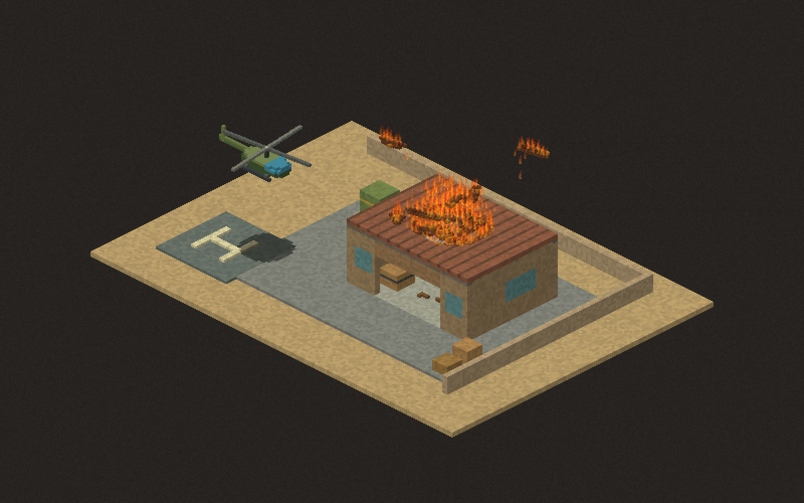

# Dust Hawk: flight and destruction engine test

Open **Scenes... > Flight & destruction lab (2.5D)** in the rebuilt editor, or double-click **Play-Flight-Test.cmd**. This is a small reusable-engine test, not a completed Desert Strike game.

- WASD or arrows: move in screen directions. Release to slow down.
- E / Q: climb / descend toward the landing pad. Buildings block low flight; climb above the roof to cross them.
- Mouse: aim at the visible surface, including rooftops. Hold left click for the gun.
- Space or right click: rockets. F: incendiary rounds.
- Wheel: zoom. P: pause. R or Reset compound: rebuild the intact test.
- The two header buttons ignite the external fuel tank or blast the roof directly.

The helicopter has a rotating rotor, tail, cockpit, skids, altitude and a projected ground shadow. Its guns and rockets sweep through actual material at their height. The hangar has separate material walls, windows, roof boards, metal roof ties, workbench, supply crate, oil tank and a small gunpowder box. Burning through the roof exposes the interior.


## Engine features, not game rules

`grave_engine::overhead` supplies:

- `Volume`: ground X/Y plus height Z. It arranges existing X/height `Sim` sections along ground Y. Each section retains the engine's material heat, burning, fluid and fracture rules. Adjacent sections exchange heat and provide oxygen through their faces. Detached solid material transfers into shared 3D rigid bodies for gravity and contacts.
- `overhead::debris::Debris`: reusable 3D fragments with mass from material density, gravity, free XYZ translation and rotation, terrain/rubble contacts, CCD, friction, bounce and sleeping. Native fracture results automatically become connected material chunks. `spawn`, `states`, `voxels`, `heat` and `blast` are public for other games.
- `box_part`: named boxes made from real material IDs, with optional surface paint. No helicopter-specific material rules.
- `Volume::load`: bounded, validated plain-text levels and reusable `.volume` prefab files. The test hangar and fuel tank are separate reusable assets in `assets/overhead/`.
- `Aircraft`, `FlightSettings`, `FlightInput`: configurable acceleration, damping, speed, climbing, collision radius and altitude-aware swept obstacle checks. A game supplies input; it can reuse this for drones or other aircraft.
- `raycast`, `Projectile`, `Explosion`: height-aware swept hits, material heating and volume blasts. Nearby explosive material cells are grouped before blast projection, preventing a charge from being repeated for every section.
- `overhead::view`: isometric projection/inverse projection, visible-surface picking, depth-sorted material rendering, shadows and arbitrary rotated visual instances. Helicopter artwork and weapon choices live in the test binary.

Units retain the existing engine convention: one cell is 10 cm and simulation steps are 1/60 second. Z increases upward; the adapter flips it to the existing section world's downward Y. Bottom two height cells form the anchored foundation. Normal side-view scenes are unchanged.

## Authoring

`scenes/flight-test.flight` starts with `size WIDTH DEPTH HEIGHT` and `spawn X Y Z`. A box line is:

```
box PART_NAME MATERIAL X Y Z WIDTH DEPTH HEIGHT [#RRGGBB]
```

`prop FILE X Y Z` places a reusable prefab, resolving FILE relative to the level. Prefab files contain the same box lines at local coordinates. Painted colours never replace physical material. Names and paths use single tokens. Unknown commands/materials, invalid dimensions and malformed coordinates are rejected. Dimensions are bounded to at most four million cells.

Other games can load these same prefabs or construct volumes with the public API. The 2D asset workshop does not yet edit overhead volumes; these prefabs are currently authored as text.

## Checks

`cargo test --release --test overhead` checks high clearance versus low wall hits, very fast projectile sweeps, flight response and damping, projection/picking, cross-section fire spread, unsupported roof collapse, reusable prefab loading and invalid inputs.

`cargo run --release --bin flight-test -- --verify` checks the intact hangar, high/low rays and a 1,800-frame native material burn. It writes intact, burning and damaged screenshots into `shots/`. It also verifies rubble velocity in both ground-depth directions. `flight-test-scatter.png` captures the initial burst; the longer burn exposes rooms.

## Current limits

This is a fixed-angle 2.5D adapter, not a freely rotating 3D world. Detached solid fragments now move, spin, collide and settle in shared 3D space, crossing any number of former section boundaries. Static support/fracture detection and fluid flow still use vertical sections; this is not yet a full 3D structural-strength or fluid solver. Aircraft use a swept fuselage collision envelope; individual rotor parts do not physically crash or detach yet. Levels load from text and reset from the source; overhead save/rewind and workshop editing are future work. Large maps need active regions rather than stepping every section.


## Shared rubble implementation

Material cells carry their physical material, paint, temperature and burn/lifetime counters into the 3D fragment. In-bounds cells briefly stamp into the native grids for heat exchange and material changes, then lift out before rigid simulation. Above/outside the grids, isolated native thermal patches keep burn and cooling rules running. Counts include unstamped material, so off-map or rotated pieces do not disappear from material accounting.

Collision cuboids are greedily merged, retaining material mass, friction and bounce while removing artificial internal voxel edges. Only changed 8³ terrain chunks rebuild their colliders. CCD catches fast fragments against thin walls. Fragments created together ignore mutual contacts for their first four physics ticks to release a shared cut face; they still hit terrain and older rubble, then collide with each other normally. Thin panels receive pressure out of their plane so a roof can open instead of remaining a jammed jigsaw. Further explosions can relaunch settled rubble.

`cargo test --release --test overhead_debris` covers travel across ground depth, native building blasts in both directions, fast wall collision, stacking/settling, solid cell conservation, airborne burning and paint, density-dependent mass/impulses, secondary blasts and actual roof-panel ejection. This is engine behavior; the flight lab does not implement a separate debris effect.

The shared solver uses [Rapier 3D](https://rapier.rs/docs/user_guides/rust/getting_started/) alongside the existing Rapier 2D section solver. Rigid rubble is 3D; static support detection remains section-based. Secondary impact-driven re-fracture, 3D liquids and overhead save/rewind remain future work.




### Fracture variety

Fracture regions now use weighted, jittered 3D crack centres rather than fixed 4 × 4 × 6 cuts. This produces unequal silhouettes and volumes, including long narrow pieces and smaller irregular fragments. Connected pieces remain separate, and material boundaries separate wood from metal. Existing paint and thermal state stay on each cell.

Other games can configure `volume.debris.fracture` (`FractureSettings`) with XYZ crack spacing, jitter and a deterministic seed. Defaults favor longer pieces along X, with substantial size variation. `FragmentState::extent` reports each piece's local dimensions. The geometry-distribution test checks varied profiles, a large size range, elongated pieces and non-cuboid silhouettes, alongside all existing collision/material tests.


### Overhead fire rendering

Gas cells are grouped into nearby visual emitters rather than drawn as flat ground-plane diamonds. Fire uses upright, flickering, camera-facing flame shapes; smoke uses soft translucent puffs. Both remain depth-sorted with the building and aircraft. Burning surfaces keep char and paint detail instead of receiving a uniform yellow tint. Burning 3D rubble carries the same flame presentation as it moves.

A bounded warm halo reuses the 2D renderer's blur. Dense fires cannot continually add bloom until the whole building clips yellow. These changes only draw existing gas/burning cells: material temperatures, fuel consumption, blast results and fire spread are unchanged. The overhead rendering tests cover upright animation, retained material detail, yellow clipping and roof occlusion.
