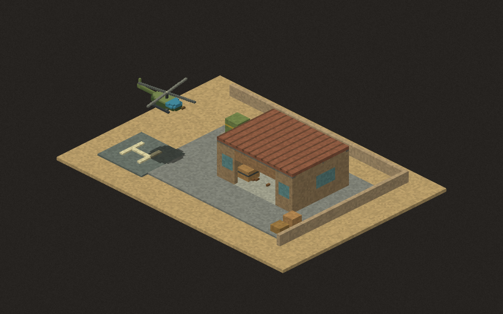
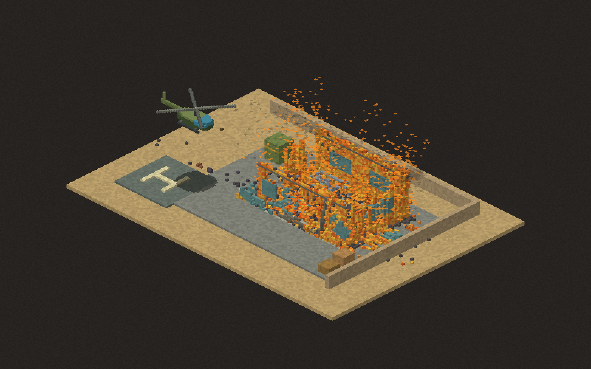

# Dust Hawk: flight and destruction engine test

Open **Scenes... > Flight & destruction lab (2.5D)** in the rebuilt editor, or double-click **Play-Flight-Test.cmd**. This is a small reusable-engine test, not a completed Desert Strike game.

- WASD or arrows: move in screen directions. Release to slow down.
- E / Q: climb / descend toward the landing pad. Buildings block low flight; climb above the roof to cross them.
- Mouse: aim at the visible surface, including rooftops. Hold left click for the gun.
- Space or right click: rockets. F: incendiary rounds.
- Wheel: zoom. P: pause. R or Reset compound: rebuild the intact test.
- The two header buttons ignite the external fuel tank or blast the roof directly.

The helicopter has a rotating rotor, tail, cockpit, skids, altitude and a projected ground shadow. Its guns and rockets sweep through actual material at their height. The hangar has separate material walls, windows, roof boards, metal roof ties, workbench, supply crate, oil tank and a small gunpowder box. Burning through the roof exposes the interior.





## Engine features, not game rules

`grave_engine::overhead` supplies:

- `Volume`: ground X/Y plus height Z. It arranges existing X/height `Sim` sections along ground Y. Each section retains the engine's material heat, burning, fluid, explosion, rigid fragmentation and downward gravity behavior. Adjacent sections exchange heat and provide oxygen through their faces.
- `box_part`: named boxes made from real material IDs, with optional surface paint. No helicopter-specific material rules.
- `Volume::load`: bounded, validated plain-text levels and reusable `.volume` prefab files. The test hangar and fuel tank are separate reusable assets in `assets/overhead/`.
- `Aircraft`, `FlightSettings`, `FlightInput`: configurable acceleration, damping, speed, climbing, collision radius and altitude-aware swept obstacle checks. A game supplies input; it can reuse this for drones or other aircraft.
- `raycast`, `Projectile`, `Explosion`: height-aware swept hits, material heating and volume blasts. Nearby explosive material cells are grouped before blast projection, preventing a charge from being repeated for every section.
- `overhead::view`: isometric projection/inverse projection, visible-surface picking, depth-sorted material rendering, shadows and arbitrary rotated visual instances. Helicopter artwork and weapon choices live in the test binary.

Units retain the existing engine convention: one cell is 10 cm and simulation steps are 1/60 second. Z increases upward; the adapter flips it to the existing section world's downward Y. Bottom two height cells form the anchored foundation. Normal side-view scenes are unchanged.

## Authoring

`scenes/flight-test.flight` starts with `size WIDTH DEPTH HEIGHT` and `spawn X Y Z`. A box line is:

```
box PART_NAME MATERIAL X Y Z WIDTH DEPTH HEIGHT [#RRGGBB]
```

`prop FILE X Y Z` places a reusable prefab, resolving FILE relative to the level. Prefab files contain the same box lines at local coordinates. Painted colours never replace physical material. Names and paths use single tokens. Unknown commands/materials, invalid dimensions and malformed coordinates are rejected. Dimensions are bounded to at most four million cells.

Other games can load these same prefabs or construct volumes with the public API. The 2D asset workshop does not yet edit overhead volumes; these prefabs are currently authored as text.

## Checks

`cargo test --release --test overhead` checks high clearance versus low wall hits, very fast projectile sweeps, flight response and damping, projection/picking, cross-section fire spread, unsupported roof collapse, reusable prefab loading and invalid inputs.

`cargo run --release --bin flight-test -- --verify` checks the intact hangar, high/low rays and a 1,800-frame native material burn. It writes intact, burning and damaged screenshots into `shots/`. The validated burn reduced hangar timber from 8,826 to 4,102 cells while exposing rooms.

## Current limits

This is a fixed-angle 2.5D adapter, not a freely rotating 3D world. Rigid fragments collide and fall inside their own vertical section; they do not yet tumble or move sideways between ground-depth sections. Liquids likewise flow within sections; heat/fire can spread between sections. Aircraft use a swept fuselage collision envelope; individual rotor parts do not physically crash or detach yet. Levels load from text and reset from the source; overhead save/rewind and workshop editing are future work. Large maps need active regions rather than stepping every section.
